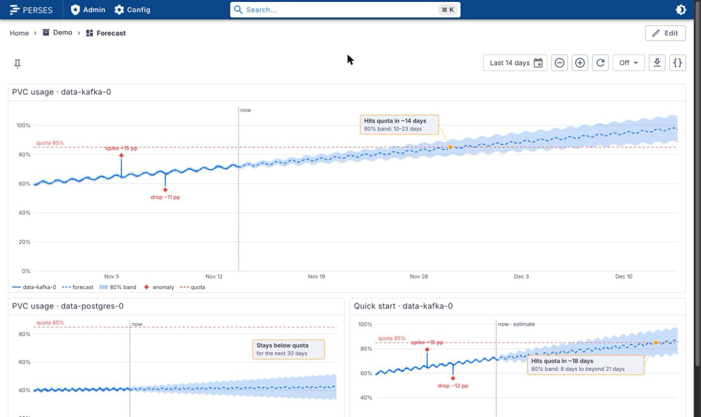
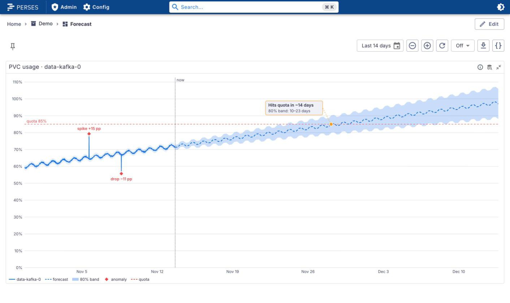
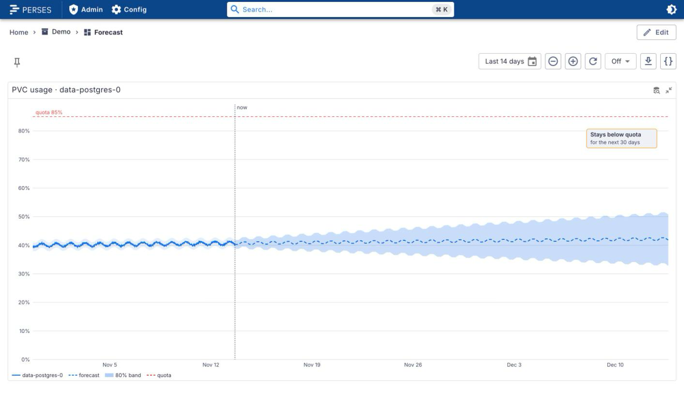
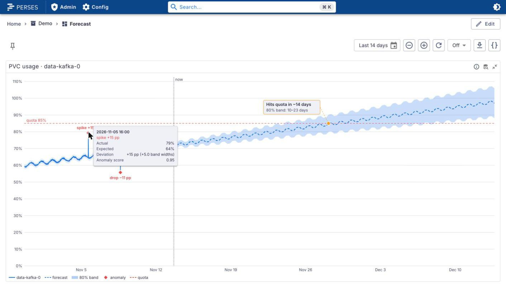
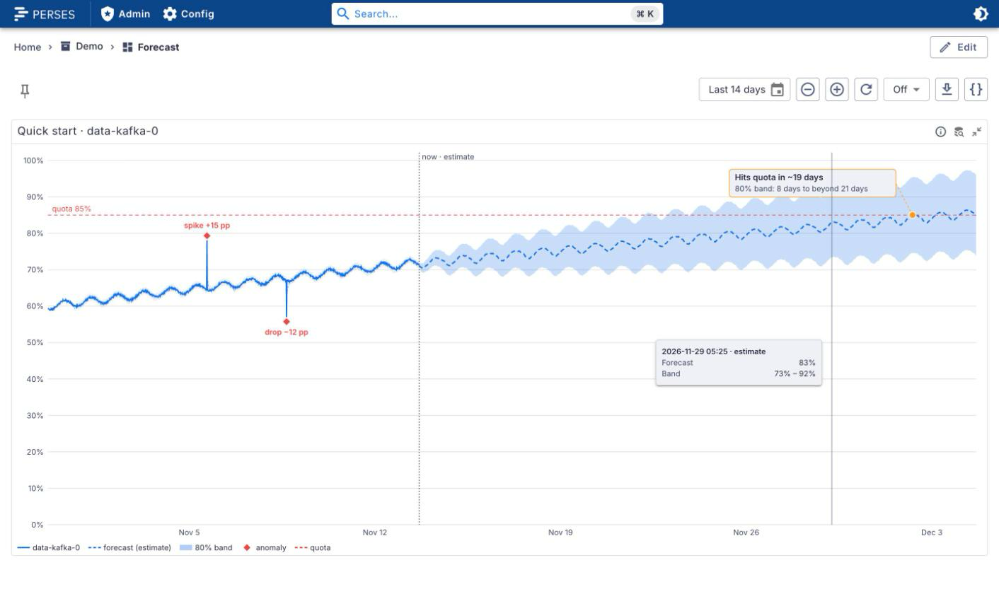

# perses-plugin-forecast

A [Perses](https://perses.dev) panel plugin, `ForecastChart`, that shows what _should_ happen next to
what did: the measured series as a solid line, a forecast as a dashed line with a confidence band,
diamond markers where reality left the expected range, and a callout for when the forecast will cross
a threshold. "Hits quota in ~14 days, 80% band: 10–23 days", instead of a straight `predict_linear`
line with no idea how sure it is.

<picture>
  <source media="(prefers-color-scheme: dark)" srcset="docs/images/dashboard-dark.png">
  
</picture>

```promql
# actual, forecast, upper, lower, anomaly: one query per role
100 * kubelet_volume_stats_used_bytes{persistentvolumeclaim="data-kafka-0"} / kubelet_volume_stats_capacity_bytes{persistentvolumeclaim="data-kafka-0"}
forecast_value{persistentvolumeclaim="data-kafka-0"}
forecast_upper{persistentvolumeclaim="data-kafka-0"}
forecast_lower{persistentvolumeclaim="data-kafka-0"}
log_anomaly_score{pod="kafka-0"}
```

## Supported versions

| Plugin | Perses  | Status              |
| ------ | ------- | ------------------- |
| 0.1.x  | v0.55.x | Tested with v0.55.1 |

The plugin is built against `@perses-dev/*` 0.55.1 and `percli` v0.55.1. Other Perses minor versions
may work but are not tested.

## What it does

Each query of the panel plays a **role**, by its position in the query list (`roles` moves them):

| Role       | Default query | Drawn as                                                                  |
| ---------- | ------------- | ------------------------------------------------------------------------- |
| `actual`   | 1st           | the solid line                                                            |
| `forecast` | 2nd           | the dashed line ahead of "now"; over the history, the faint expected line |
| `upper`    | 3rd           | top edge of the shaded band                                               |
| `lower`    | 4th           | bottom edge of the shaded band                                            |
| `anomaly`  | 5th           | a score or 0/1 flag; above `anomalyThreshold` is an anomaly               |

A role whose query is missing is off. Only `actual` is required.

- **Forecast and band.** The forecast is drawn dashed from "now" to the end of its horizon, with the
  band shaded between `lower` and `upper`. The x-axis runs past the dashboard's end time to cover the
  whole horizon. Over the history, the same series give the expected line and band at half the
  opacity, so you can see where the actual series left them. A vertical "now" line splits the two.

  <picture>
    <source media="(prefers-color-scheme: dark)" srcset="docs/images/forecast-dark.png">
    
  </picture>

- **Threshold crossing.** With a `threshold`, a callout tied to the crossing point by a dashed line
  says when the forecast reaches it and when the two band edges do:
  - "Hits quota in ~14 days · 80% band: 10–23 days" when the forecast crosses;
  - "… 80% band: 8 days to beyond 21 days" when the far band edge never crosses within the horizon;
  - "May reach quota in ~9 days · only the 80% band edge; forecast does not" when only the near edge
    crosses;
  - "Already past quota" when the forecast starts beyond it;
  - "Stays below quota for the next 30 days" when nothing crosses.

  `direction: below` checks for falling under the value instead (free disk, error budget).

  <picture>
    <source media="(prefers-color-scheme: dark)" srcset="docs/images/stays-below-dark.png">
    
  </picture>

- **Anomalies** are diamonds on a stem from the actual line, labelled with the deviation ("spike
  +15 pp", "drop −11 pp"), so they read without colour. A point is an anomaly when the `anomaly`
  score is over `anomalyThreshold`, or when the actual value is well outside the expected band (more
  than 1.5 half-band-widths from the expected value; excursions less than an hour apart count as
  one). Hovering, or focusing a diamond with Tab, shows actual, expected, the deviation in units and
  in band widths, and the score. With `anomalyLink`, a diamond is a link (Enter opens it), for
  example to the logs of that pod around that time.

  <picture>
    <source media="(prefers-color-scheme: dark)" srcset="docs/images/anomaly-dark.png">
    
  </picture>

- **Quick start** (`quickStart`, off by default). With only `actual` and no forecast data, the panel
  fits a forecast in the browser: additive Holt-Winters with a daily season when there are at least
  two days of history, otherwise Holt's linear trend, `horizon` ahead (default `7d`). The band comes
  from the one-step residuals and the trend's standard error. It is an **estimate**: the "now" line
  says "now · estimate", the legend says "forecast (estimate)", and so does every tooltip. Forecast
  data, when there is any, always wins.

  <picture>
    <source media="(prefers-color-scheme: dark)" srcset="docs/images/estimate-dark.png">
    
  </picture>

- Hovering anywhere shows a crosshair and the values at that time: actual, expected and deviation in
  the history, forecast and band ahead.
- The legend (`legend`) names each part: the series, forecast, band, anomaly and threshold.
- Problems with the setup (a role pointing at a missing query, two roles on one query, several
  actual series) show as a short note under the chart; with no actual data the panel says so.
- Light and dark themes follow Perses. Long series are reduced to a min and max per pixel column
  before drawing, so spikes survive and weeks of 30 s samples stay smooth.

## Feeding it from your own anomaly model

The panel reads ordinary Prometheus series. A forecasting job (a recording rule, a CronJob writing
over remote-write, or a forecast datasource later) writes three series per thing it forecasts, plus an
optional score:

| Metric              | Labels                                              | Value                                                |
| ------------------- | --------------------------------------------------- | ---------------------------------------------------- |
| `forecast_value`    | the series' own labels + `horizon`                  | the expected value `horizon` after the sample's time |
| `forecast_upper`    | same                                                | upper edge of the band (80% by default)              |
| `forecast_lower`    | same                                                | lower edge of the band                               |
| `log_anomaly_score` | whatever identifies the source (`namespace`, `pod`) | a score from 0 to 1, or a 0/1 flag                   |

These are the names the demo uses. Any names work, since each query is mapped to a role.

**Why a `horizon` label.** A Prometheus range query only returns samples up to "now", so a forecast
for next week cannot be stored at next week's timestamp. Instead, at each evaluation time `t` the job
writes one sample per horizon `h`, holding the prediction for `t + h`:

- `horizon="0"` is the model's expected value for `t` itself. Recorded over time, it is the expected
  line and band over the history, which the actual series is checked against for anomalies.
- `horizon` > 0 (in seconds, or a duration such as `6h`) is the forecast. The panel takes the newest
  sample of each horizon series and draws it at its timestamp plus `h`; sorted by `h`, those points
  are the forecast line and band. Every 6 hours out to 30 days is 121 series per metric.
- A series **without** the label is drawn at its own timestamps, so a datasource that returns real
  future timestamps needs no label at all.

The label name is configurable (`horizonLabel`). A minimal recording rule, a straight-line forecast
with a fixed band, shows the shape (one group of rules per horizon):

```yaml
groups:
  - name: pvc-forecast
    rules:
      - record: forecast_value
        expr: predict_linear(pvc_usage_percent[3d], 7 * 86400)
        labels: { horizon: "604800" }
      - record: forecast_upper
        expr: predict_linear(pvc_usage_percent[3d], 7 * 86400) + 5
        labels: { horizon: "604800" }
      - record: forecast_lower
        expr: predict_linear(pvc_usage_percent[3d], 7 * 86400) - 5
        labels: { horizon: "604800" }
```

A real model (Prophet, statsforecast, your own) writes the same series with its own band.

## Spec

```yaml
kind: ForecastChart
spec:
  roles: # optional; query index (0-based) per role, these are the defaults
    actual: 0
    forecast: 1
    upper: 2
    lower: 3
    anomaly: 4
  horizonLabel: horizon # default
  threshold: # optional
    value: 85
    label: quota # default "threshold"
    direction: above # above (default) | below
  anomalyThreshold: 0.5 # default; works for 0/1 flags
  band:
    opacity: 0.25 # default
    label: 80% # default
  quickStart: false # default; Holt-Winters estimate in the browser
  horizon: 7d # default; how far the estimate looks ahead
  crossingCallout: true # default
  anomalyLink: "https://logs.example.com/search?pod=${__series.labels.pod}&from=${__time_from}&to=${__time_to}"
  format: { unit: percent, decimalPlaces: 0 } # Perses common.#format
  legend: { position: bottom } # Perses common.#legend; hidden when unset
```

`anomalyLink` replaces `${__time}` (the anomaly's time in ms), `${__time_from}` and `${__time_to}` (5
minutes either side), `${__series.labels.<name>}` (a label of the anomaly's series, URL-encoded) and
dashboard variables. Only `http`, `https` and relative links are followed.

The CUE schema is `schemas/panels/forecast-chart/forecast-chart.cue`, with an example next to it. The
panel editor has a field for every option.

## Try it locally

`dev/` runs Perses with the plugin, a Prometheus, and a made-up generator: two PVCs over 14 days
(`data-kafka-0` growing from 60% to 72% with a daily wave, a spike of +15 pp and a drop of −11 pp;
`data-postgres-0` flat near 40%), their forecasts with a `horizon` label, and a log anomaly score that
rises at the spike and the drop. The history is backfilled with `promtool`, then the same series are
scraped live. The screenshots above come from it. It needs `podman compose` or `docker compose`.

```bash
npm ci && npm run build && percli plugin build
cp Forecast-*.tar.gz dev/archive/
podman compose -f dev/compose.yaml up -d    # PERSES_PORT=... to move it off 18081
```

Open <http://localhost:18081/projects/demo/dashboards/forecast>. The backfill takes about a minute on
the first start. `podman compose -f dev/compose.yaml down -v` removes it again.

## Build

```bash
npm ci
npm run build          # module-federation bundle in dist/
percli plugin build    # writes Forecast-<version>.tar.gz
```

See `CONTRIBUTING.md` for the checks and the release process.

## Install into Perses

Perses extracts every `*.tar.gz` in `plugin.archive_paths` into `plugin.path` at startup. Setting
`archive_paths` replaces the default, so keep the directory of bundled plugins in the list. Pick one
of the three options below and restart Perses.

### Option A: release archive

Download `Forecast-<version>.tar.gz` from the
[GitHub releases](https://github.com/astrona-io/perses-plugin-forecast/releases), put it in a directory
Perses can read, and add that directory to the config:

```bash
curl -fLO https://github.com/astrona-io/perses-plugin-forecast/releases/download/v0.1.0/Forecast-0.1.0.tar.gz
```

```yaml
plugin:
  archive_paths:
    - /etc/perses/plugins-archive # plugins bundled with Perses
    - /etc/perses/plugins-archive-forecast # put Forecast-0.1.0.tar.gz here
```

### Option B: Kubernetes image volume

The `Containerfile` packages the archive as a plugin-only OCI image (`FROM scratch`, the archive at the
image root). Every release publishes it as `ghcr.io/astrona-io/perses-plugin-forecast:v<version>` for
linux/amd64 and linux/arm64, so you can use that image directly. To build and push it to your own
registry instead:

```bash
percli plugin build
podman build -t ghcr.io/<owner>/perses-plugin-forecast:<version> .
podman push ghcr.io/<owner>/perses-plugin-forecast:<version>
```

Then mount it into the Perses pod as an
[image volume](https://kubernetes.io/docs/concepts/storage/volumes/#image) and add the mount path to
`archive_paths` as in option A. Image volumes need a cluster and container runtime that support them
(the `ImageVolume` feature; check your Kubernetes version and feature gates).

```yaml
volumes:
  - name: forecast-plugin
    image:
      reference: ghcr.io/astrona-io/perses-plugin-forecast:v0.1.0
      pullPolicy: IfNotPresent
containers:
  - name: perses
    volumeMounts:
      - name: forecast-plugin
        mountPath: /etc/perses/plugins-archive-forecast
        readOnly: true
```

If the registry is private, add an `imagePullSecrets` entry to the pod as for any other image.

### Option C: custom Perses image

Copy the archive into the directory of bundled plugins. No config change is needed, because that
directory is in the default `archive_paths`:

```dockerfile
FROM persesdev/perses:v0.55.1
COPY Forecast-0.1.0.tar.gz /etc/perses/plugins-archive/
```

## Licences and credits

The plugin is Apache-2.0 (`LICENSE`). Third-party material and its notices are listed in `NOTICE`:
the Perses shared CUE schemas, vendored into the archive at build time (Apache-2.0).
